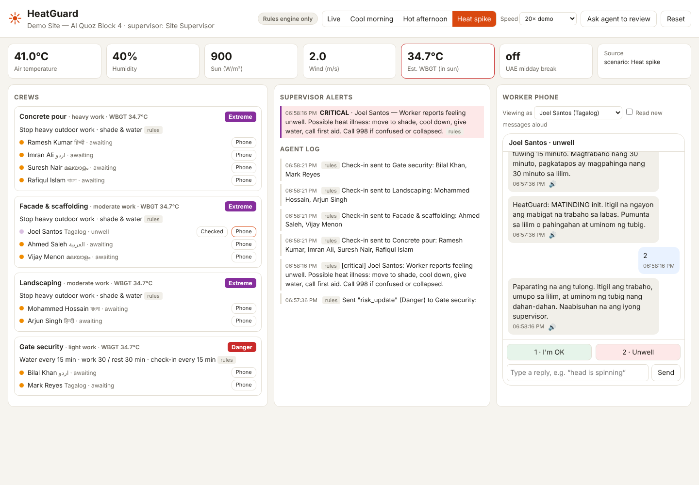
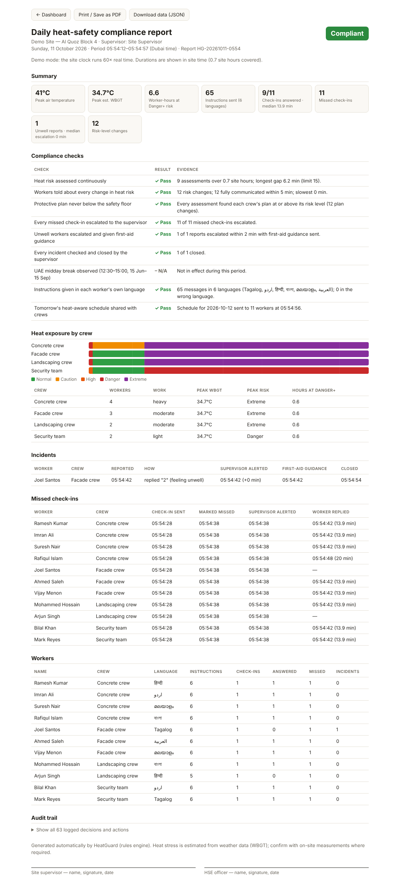

# HeatGuard

An AI agent that protects outdoor workers from heat stress. Entry prototype for the Dubai
**Create AI Agents Championship** (Best Societal AI Agent). See
[`../ai-agents-championship/PLAN.md`](../ai-agents-championship/PLAN.md) for the plan.



## What it does

1. **Perceives.** Pulls site weather (Open-Meteo) and estimates heat stress (WBGT) for each
   crew, adjusted for how heavy their work is.
2. **Reasons.** When something changes (risk level moves, a worker misses a check-in, a worker
   says they feel unwell or sends a message), Claude inspects the site and decides what to do.
3. **Acts.** Sets each crew's water and work/rest schedule, sends alerts to workers in their
   own language (Hindi, Urdu, Malayalam, Bengali, Tagalog, Arabic, English) with voice
   playback, asks workers to check in ("reply 1 if OK, 2 if unwell"), and escalates to the
   supervisor.
4. **Guarantees a safety floor.** A deterministic rules engine runs every tick. Whatever the
   model does, or if it's unreachable, every crew has at least the standard protective plan,
   every worker knows the current level, and every missed check-in or unwell report reaches the
   supervisor. The agent can make the response **stricter**, never weaker.

It also follows the UAE midday break (no outdoor work 12:30–15:00, 15 June – 15 September).

### Planner agent: "Plan tomorrow"

The **Plan tomorrow** tab schedules tomorrow's work around tomorrow's heat.

1. Takes tomorrow's hourly forecast (live from Open-Meteo, a typical day for the month, or a
   45 °C summer heatwave preset for demos) and the site's task list. Each task has a crew,
   productive hours, work intensity, sun/shade, and whether it can be split or needs daylight.
2. Shows **the usual plan** (everyone starts at 07:00): on a heatwave day work stalls in
   Extreme heat and tasks don't finish.
3. Builds a **rules-based heat-aware plan** that is always valid: heavy work goes into the
   coolest feasible hours, with split shifts where allowed and a 10-hour duty limit per crew.
   Mandatory rest stretches clock time in the heat, so cooler hours are also more productive.
4. **Claude** reviews the forecast, tries alternatives with `evaluate_plan`, and submits a plan
   with a supervisor briefing and logistics (water, cooling stations, lighting for night work,
   guard rotation). The server rejects any submitted plan with a violation (Extreme heat,
   midday break, no daylight, overlaps, over the duty limit, unfinished tasks).
5. Shows before/after numbers (time in Danger-level heat, work stopped, unfinished tasks,
   mandatory rest, water, night hours) and two timelines coloured by heat level.
6. **Send schedule to crews** tells every worker tomorrow's start and finish in their own
   language.

### Design choices worth pitching

- **The LLM decides, templates speak.** Claude picks which pre-translated message to send. It
  never writes free text to workers, so safety instructions stay consistent and reviewed.
- **Event-driven reasoning.** Routine work (reminders, timeouts) is plain code. Claude is only
  called when something needs judgement, which keeps it cheap and fast.
- **Free-text understanding.** A worker can reply "sir head is spinning" or reply in Hindi;
  Claude reads it and escalates as critical. Without the agent, free text goes to a human.

### Daily compliance report

**Compliance report** (top bar, or `/report`) produces a printable, signable report of the
shift, built from evidence recorded as the system runs. Use the browser's **Print / Save as
PDF**; the raw data is at `/api/report`.

- **Status:** Compliant / Attention needed / Non-compliant
- **Checks, each with its evidence:** heat assessed continuously; workers told about every
  risk change within 5 min; plans never below the safety floor; every missed check-in
  escalated; unwell workers escalated within 2 min with first-aid guidance; incidents closed
  by the supervisor; UAE midday break observed; instructions in each worker's language;
  tomorrow's schedule shared
- Heat exposure timeline per crew, incident and missed check-in timelines, per-worker table,
  the full audit trail, and signature lines for the supervisor and HSE officer



## Run it

```bash
cd heatguard
npm install
npm start                       # http://localhost:4200
```

It runs with the **rules engine only** until you give it Claude credentials:

```bash
export ANTHROPIC_API_KEY=sk-ant-...
npm start
```

| Env var | Default | |
|---|---|---|
| `ANTHROPIC_API_KEY` | – | Turns on the Claude agent |
| `HEATGUARD_MODEL` | `claude-opus-5-5` | Model for the agent |
| `HEATGUARD_AGENT` | – | Set to `rules` to force rules-only mode |
| `PORT` | `4200` | |

The agent uses server-side refusal fallbacks (`fallbacks: "default"`), so if the model ever
declines a request the API retries it on a fallback model. If everything fails, the rules
engine still acts.

## Demo script (about 3 minutes)

1. Start on **Cool morning**. Everyone is Normal/Caution. Open a worker's phone on the right.
2. Click **Heat spike**. Crews jump to Danger/Extreme. Workers get the new schedule in their
   language; tick "Read new messages aloud" to hear it.
3. At **20× demo** speed, check-ins arrive about every 45 seconds. Reply **1** for some workers
   and ignore others. After about 30 seconds, missed check-ins escalate to the supervisor.
4. On a worker's phone, type something like *"feeling dizzy"* (with Claude enabled). The agent
   sends first-aid guidance and raises a **critical** alert. Or press **2 · Unwell**.
5. Click **Checked** on the supervisor side to close the loop.
6. Switch to **Plan tomorrow**, choose **Summer heatwave**, and press **Plan tomorrow**. Compare
   the usual 07:00 plan (work stopped for hours, tasks unfinished) with the HeatGuard plan
   (concrete pour moved to 03:00, rebar to the evening, everything finished). Press
   **Send schedule to crews** and open a worker's phone on the Live tab.
7. Click **Compliance report** to show the day's evidence: every check passed, the incident
   timeline, and signature lines, ready to print as a PDF.

## How it's built

```
src/heat.js      WBGT estimate (Stull wet-bulb + globe temp), risk levels, floor plans, midday rule
src/weather.js   Open-Meteo, a simulated Dubai profile as fallback, demo scenarios
src/i18n.js      Worker message templates in 7 languages
src/store.js     In-memory site state, outbox, supervisor alerts
src/claude.js    Shared Claude tool-use loop (with server-side refusal fallback)
src/agent.js     Live agent tools: get_site_status, set_crew_plan, send_worker_message, escalate_to_supervisor
src/planner.js   Shift planning: heat per 15-min slot, plan validation, usual plan, rules planner
src/planner-agent.js  Planner agent tools: get_planning_context, evaluate_plan, submit_plan
src/records.js   Evidence recorder (heat samples, risk notices, check-ins, incidents, plans)
src/report.js    Daily compliance report: checks, metrics, printable HTML
src/monitor.js   Tick loop: perceive → detect events → Claude → safety floor → routine check-ins
src/server.js    Express API + static dashboard
public/          Supervisor dashboard, worker phone simulator, planner view (no build step)
```

```bash
npm test   # heat maths, translations, safety floor, planner validation, compliance report
```

## Limits (prototype)

- WBGT is **estimated** from weather data. A real deployment should use on-site WBGT meters.
- Risk thresholds loosely follow ACGIH / ISO 7243 action limits for acclimatised workers. They
  need review by an occupational health professional.
- Translations are drafts. Have native speakers check them before a pilot.
- State is in memory and messages go to the on-screen phone simulator.

## Next steps

- Telegram bot, then WhatsApp Business, for real phones; text-to-speech voice notes
- Speech-to-text so workers can reply by voice
- Persistence (SQLite → Postgres), multiple sites, supervisor login
- Daily compliance report (breaks taken, check-in rate, incidents) for employers
- Pilot with one crew to get real numbers for the pitch deck
