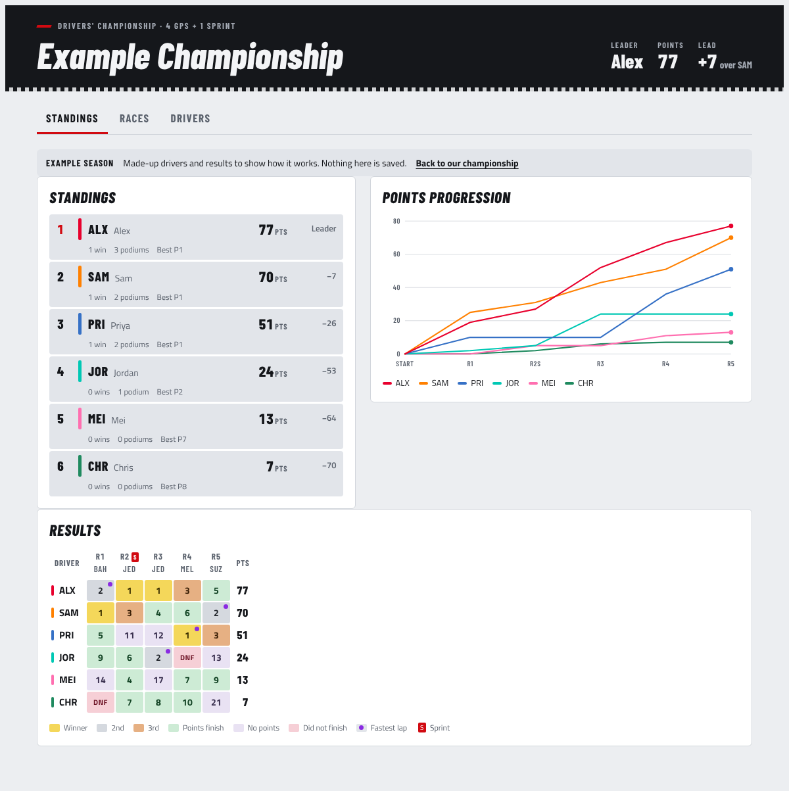

# Paddock Championship

An F1-style drivers' championship for a group of friends racing in an F1 game. After each race,
everyone enters where they finished in the full 22-car field, AI cars included. The page then
works out the standings with real F1 points.

Live page: <https://claude.ai/artifact/FvKAj8V2zVfyJsNHrhhWNc>

## What it does

- **Standings:** a timing-tower table with points, wins, podiums, best finish and gap to the
  leader. Next to it is a chart of each driver's points after every race.
- **Results grid:** one cell per driver per race. The colours follow the usual F1 style: gold,
  silver and bronze for the podium, green for a points finish, red for DNF, and a purple dot for
  fastest lap.
- **Log a race:** pick each friend's position (P1 to P22), mark DNF, or leave them as "Didn't
  race". A friend who finished in the top 10 can take the fastest-lap point. If two friends pick
  the same position, the race won't save.
- **Dry run:** while you fill in a race, a panel shows how the standings would change if you
  saved it. **Clear fields** resets the form. Nothing is saved until you press **Save race**.
- **Drivers:** a name, a 3-letter code, a car number and a team colour for each friend.

## Scoring

| Session | Points |
| --- | --- |
| Grand Prix | 25, 18, 15, 12, 10, 8, 6, 4, 2, 1 for P1 to P10 |
| Sprint | 8, 7, 6, 5, 4, 3, 2, 1 for P1 to P8 |
| Fastest lap (optional) | +1 in a Grand Prix, top-10 finishers only |

Ties are decided on countback: most Grand Prix wins, then most second places, and so on.

## How it runs

`paddock-championship.html` is the source of a claude.ai Artifact. Its drivers, races and
season settings live in the Artifact's shared database, which is why everyone with access sees
the same data, updated live:

| Path | Contents |
| --- | --- |
| `drivers/<id>` | `name`, `code`, `number`, `color` |
| `races/<id>` | `name`, `date`, `sprint`, `positions` (`{driverId: 1-22}`), `dnf` (`[driverId]`), `fastestLap` |
| `season/settings` | `name`, `fastestLap` |

If you open the file directly in a browser, there is no shared database. The page shows an
offline notice, and the example season still works so you can preview it. To publish changes,
republish this file to the same Artifact link.

## Sharing so friends can edit

Use the Share menu on the live page. Invite each friend by email with **Editor** access, and
don't also turn on a public link. While a public link is on, people outside your organization
can only view. Friends on the same claude.ai Team or Enterprise plan as you can be given
**Contributor** access instead.
