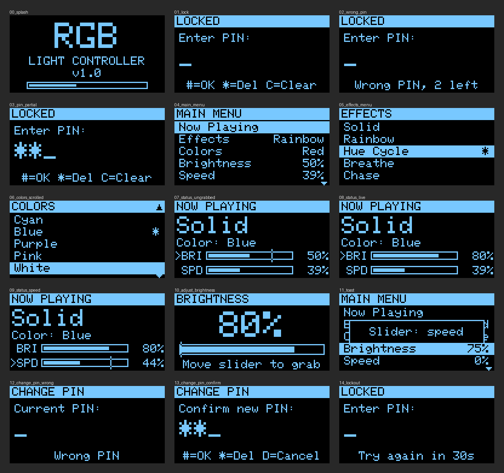

# RGB Light Controller

An Arduino sketch for a PIN-locked RGB light controller with an OLED menu.

- A **startup screen** plays on the 128×64 OLED (with a rainbow fill on the LEDs), then the **PIN
  lock**, then the **main menu**.
- The **joystick** moves through the menus. Its **push-button** selects.
- The **4×4 keypad** enters the PIN. Once unlocked, its letter keys work as shortcuts.
- **Effects:** Solid, Rainbow, Hue Cycle, Breathe and Chase, with 10 preset colors.
- The **sliding potentiometer** sets **brightness** or **animation speed**.
- The **Now Playing** screen shows the active effect, color, brightness and speed.
- Settings and the PIN are saved to EEPROM, so they survive a power cycle.



## Parts

| Part | Notes |
| --- | --- |
| Arduino Uno or Nano (ATmega328P) | Mega 2560 also works and has more RAM to spare |
| 0.96" 128×64 SSD1306 OLED, I2C | Address `0x3C` (some boards use `0x3D`) |
| Analog joystick module (VRx / VRy / SW) | |
| 4×4 membrane keypad | |
| Slide potentiometer, 10 kΩ linear | |
| WS2812B / NeoPixel strip or ring | 8 LEDs by default |
| 330 Ω resistor and 1000 µF capacitor | Data-line resistor and supply cap for the strip |
| 5 V supply | A separate supply for strips with more than ~8 LEDs |

## Wiring (defaults in `config.h`)

| Signal | Arduino pin |
| --- | --- |
| OLED SDA / SCL | A4 / A5 |
| Joystick VRx / VRy | A0 / A1 |
| Joystick SW | D2 (to GND when pressed, internal pull-up) |
| Slide pot wiper | A2 (outer legs to 5 V and GND) |
| LED strip DIN | D6, through the 330 Ω resistor |
| Keypad rows 1–4 | D3, D4, D5, D7 |
| Keypad columns 1–4 | D8, D9, D10, D11 |

Connect all grounds together. If you power the strip from its own supply, join its GND to the
Arduino's GND. Pins, LED count, chipset, the power budget and every timing value are set in
[`config.h`](config.h). Edit that file instead of the sketch.

## Building

Install the libraries with the Arduino IDE Library Manager or with `arduino-cli`:

```sh
arduino-cli core install arduino:avr
arduino-cli lib install "Adafruit SSD1306" "Adafruit GFX Library" FastLED Keypad
arduino-cli compile --fqbn arduino:avr:uno rgb-controller
arduino-cli upload  --fqbn arduino:avr:uno -p /dev/ttyUSB0 rgb-controller
```

The library versions this was tested with are Adafruit SSD1306 2.5.13, Adafruit GFX 1.12.1,
FastLED 3.9.4 and Keypad 3.1.1. CI compiles the sketch for the Uno on every push.

## Using it

**Startup.** The splash screen runs for 2.5 seconds. Any key or joystick input skips it. Next comes
the lock screen. The default PIN is **`1234`**.

**PIN entry.** Digits type the PIN, up to 8 digits. `*` deletes a digit, `C` clears the entry and
`#` submits it. Three wrong PINs in a row lock the keypad for 30 seconds.

**Main menu.**

| Item | What it does |
| --- | --- |
| Now Playing | Status screen: effect, color, brightness and speed bars |
| Effects | Pick an effect. `*` marks the active one |
| Colors | Pick a color. If the current effect is Rainbow or Hue Cycle, the effect switches to Solid |
| Brightness / Speed | Full-screen adjust. The slider sets the value and joystick up/down changes it by 5% |
| Change PIN | Enter the current PIN, then the new PIN twice (4–8 digits). `D` cancels |
| Lock | Back to the lock screen |

**Joystick.** Up and down move the cursor (hold to repeat). Press or push right to select. Push
left to go back. On Now Playing, left and right switch which setting the slider controls, and up
and down nudge that setting by 5%.

**Keypad shortcuts (unlocked).** `A` opens Effects, `B` opens Colors, `C` switches the slider
between brightness and speed, and `D` goes back.

**The slider uses soft takeover.** It changes a value only after you move it to the value's
current level. On boot, after unlocking, after switching between brightness and speed, or after a
joystick nudge, a tick on the bar shows where the slider is. Slide it across the bar's fill level
to grab the value. This way the lights never jump to wherever the slider happened to be.

While the controller is locked, the LEDs keep running the current effect, but the joystick and
slider do nothing. Set `AUTO_LOCK_MS` in `config.h` to lock automatically after a period with no
input.

If the OLED isn't detected, the first LED blinks red. Check SDA/SCL and `OLED_I2C_ADDR`.

## Notes

- **RAM on the Uno.** The OLED frame buffer takes 1 KB of the Uno's 2 KB. The sketch keeps its
  strings and tables in flash and leaves about 270 bytes for the stack. If you add features, use
  a Mega 2560 or move to a board with more RAM.
- **Power.** FastLED limits the strip's current to `LED_MAX_MILLIAMPS`, which defaults to 500 mA so
  the strip can safely run from USB. Raise the limit only when the strip has its own supply.
- **Joystick orientation.** Modules are mounted in different ways. If up/down or left/right come
  out reversed, flip `JOY_INVERT_X`, `JOY_INVERT_Y` or `JOY_SWAP_XY`. If the slider runs
  backwards, flip `SLIDER_INVERT`.
